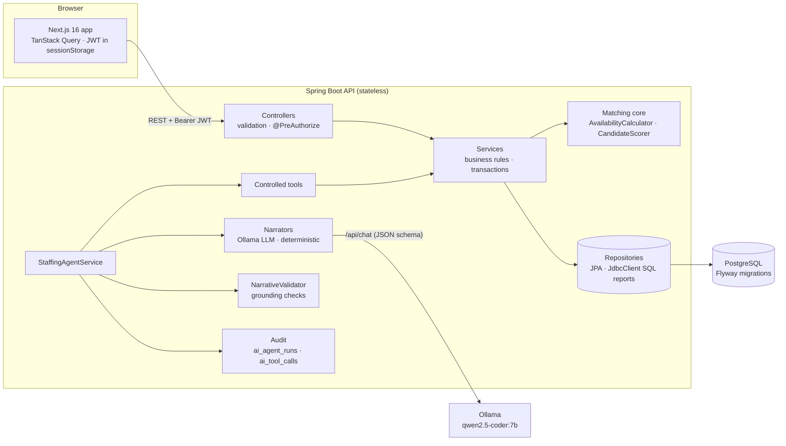
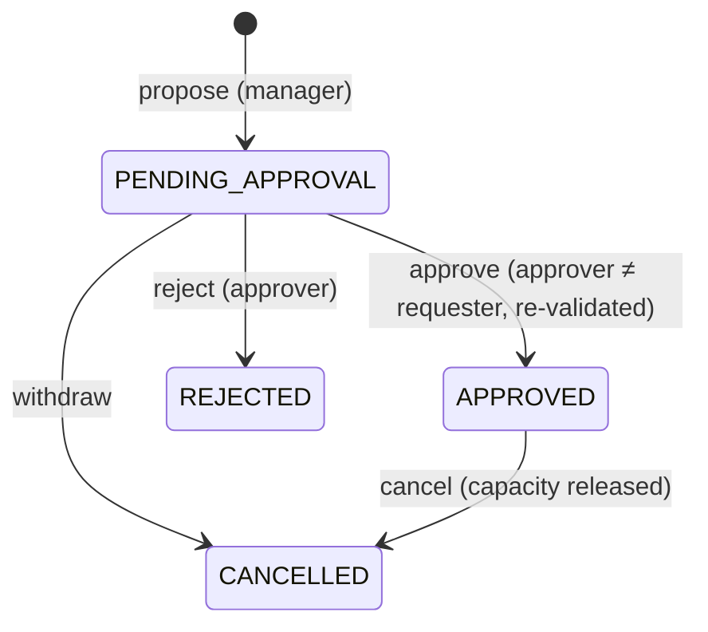
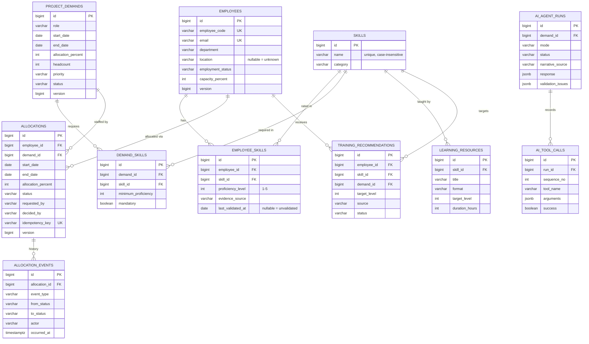

# Talent — Resource Management & AI Staffing

Match people to project demand by **verified skills, day-accurate availability, capacity and location**, approve
allocations through a **four-eyes workflow**, and let a **goal-driven AI agent** (Qwen 2.5 Coder 7B via Ollama)
explain every recommendation — fact-checked against stored records, never invented.

| | |
|---|---|
| Backend | Java 25 · Spring Boot 4.1 · Spring Data JPA (Hibernate 7) · Spring Security (JWT) · Flyway · PostgreSQL 17/18 |
| Frontend | Next.js 16 (App Router, Cache Components) · React 19 · TypeScript · Tailwind CSS 4 · TanStack Query |
| AI | Ollama + `qwen2.5-coder:7b`, JSON-schema constrained output, controlled tools, grounding validator, audit trail |
| Tests | JUnit 5 · Mockito · Spring MockMvc · real PostgreSQL (local DB or Testcontainers) — **73 tests** |

---

## Contents
1. [Quick start](#quick-start)
2. [Architecture](#architecture)
3. [Business rules](#business-rules)
4. [AI staffing agent](#ai-staffing-agent)
5. [Data model](#data-model)
6. [API](#api)
7. [SQL reports](#sql-reports)
8. [Testing](#testing)
9. [Security](#security)
10. [Configuration](#configuration)
11. [Troubleshooting](#troubleshooting)
12. [Assumptions and decisions](#assumptions-and-decisions)

---

## Quick start

### Prerequisites
- **JDK 25** (Maven is bundled via `./mvnw`)
- **Node.js 20+** (24 recommended) and npm
- **PostgreSQL 17+** (local install) *or* **Docker Desktop**
- **Ollama** with `qwen2.5-coder:7b` (`ollama pull qwen2.5-coder:7b`) — optional; without it the agent runs in a clearly labelled simulation mode

### Option A — run locally
```bash
cp .env.example .env            # set DB_PASSWORD, JWT_SECRET and the demo passwords
```
Create the two databases once (`talent_management` for the app, `talent_management_test` for the tests), e.g. in `psql`:
```sql
CREATE DATABASE talent_management;
CREATE DATABASE talent_management_test;
```
Start the API (Flyway creates the schema and loads synthetic demo data on first start):
```bash
cd server && ./mvnw spring-boot:run
```
Start the web app in a second terminal:
```bash
cd client && npm install && npm run dev
```
Open **http://localhost:3000** and sign in as `manager`, `approver` or `admin` (passwords: `.env`, defaults in `.env.example`).
API docs: **http://localhost:8080/swagger-ui.html**.

### Option B — Docker Compose
```bash
cp .env.example .env            # set DB_PASSWORD and JWT_SECRET
docker compose up --build
```
PostgreSQL is published on port **5433** (so it does not clash with a local install), the API on 8080, the web app on 3000.
The API reaches Ollama on the host via `host.docker.internal`; to run Ollama in a container use
`docker compose --profile ollama up` and set `OLLAMA_DOCKER_URL=http://ollama:11434`.

### Demo data
`server/src/main/resources/db/seed/R__synthetic_seed_data.sql` loads **fictional** people, skills, demands, allocations
(approved, pending, rejected, cancelled), a learning catalogue and training actions — only into an empty database, with
dates relative to today so the demo never goes stale. Remove `classpath:db/seed` from `FLYWAY_LOCATIONS` for a clean database.

Try these flows:
- **Overview** → utilisation by department, skill gaps, demands with no eligible candidate.
- **Demands → Atlas Payments Platform** → ranked candidates; expand *Why this score*; select two and **Compare**.
- **Propose** a candidate, then sign in as `approver` → **Approvals** → approve (re-validated at commit).
- **Assistant** → ask *“Assume Meera Iyer is an expert in Kafka and fully available. Is she the best choice?”* and watch the
  fact-checker refuse the invented data.
- **Vega Embedded Telemetry** (Rust) → no eligible candidate → the agent re-plans to learning paths for near-misses.

---

## Architecture



**Layering** (`server/src/main/java/com/talent/management`):

| Package | Responsibility |
|---|---|
| `controller` | HTTP mapping, request validation, role checks. No business logic. |
| `dto.request` / `dto.response` / `dto.validation` | API contracts (records), bean validation incl. the `@ValidDateRange` class constraint |
| `service` | Use cases and rules, transaction boundaries, locking |
| `service.matching` | Pure, unit-tested rules: availability sweep, eligibility and scoring |
| `service.ai` | Agent orchestration, tools, narrators, validator, audit |
| `repository` | Spring Data repositories, composable `Specifications`, SQL reports (`ReportRepository`) |
| `entity` / `enums` | JPA aggregates with lifecycle methods (e.g. `Allocation.approve/cancel` append history) |
| `exception` | `ApiException` + `ErrorCode` → RFC 9457 problem documents |
| `config` / `security` | Typed `@ConfigurationProperties`, JWT security, CORS, OpenAPI, clock |

**Frontend** (`client/`): `app/(app)/*/page.tsx` are thin server pages (metadata) rendering a client `*-view.tsx`;
`lib/api` holds typed DTOs, the fetch client (problem-document aware) and React Query hooks with targeted cache
invalidation; `components/ui` is the design system (light & dark tokens in `app/globals.css`), `components/domain` holds
staffing visuals (score ring and breakdown, availability timeline, level bars, candidate cards, propose dialog).

---

## Business rules

All rules are enforced in Java services; the UI and the AI only display their results.

### Demand
Role, project, a valid date range (`end ≥ start`, start not in the past), allocation % (1–100), priority are mandatory;
headcount 1–50 (default 1). Skills are listed once each with a minimum level 1–5 and a mandatory flag.
Status: `OPEN → PARTIALLY_FILLED → FILLED` follows approved allocations vs. headcount; `CANCELLED` releases all its allocations.

### Availability (per day, not summed)
`AvailabilityCalculator` splits the requested range at every booking boundary (sweep line, `O(b log b)`), sums
**pending + approved** allocations per day, and reports windows, peak load, minimum free capacity and coverage.
- **FULL** – the requested % fits on every day · **PARTIAL** – fits on some days or some capacity is free · **NONE** – no free capacity on any day.
- Effective capacity = `min(employee.capacityPercent, MAX_CAPACITY_PERCENT)` (part-time aware).

### Eligibility (hard rules, in order)
1. Employment status is `ACTIVE` or `BENCH`.
2. Every **mandatory** skill is stored at ≥ the minimum level. `MANDATORY_SKILL_POLICY=EXCLUDE` (default) removes the
   candidate with the reason; `FLAG` keeps them visible, marked ineligible and ranked after eligible people.
3. Availability is not `NONE`.

### Transparent score (0–100)
`score = skillFit × 0.50 + availability × 0.30 + location × 0.15 + evidenceQuality × 0.05` (weights configurable, validated to sum to 1).

| Factor | Formula |
|---|---|
| Skill fit | Weighted mean of per-skill points (mandatory ×2, optional ×1). Met: `0.70 + 0.30 × (level − required)/(5 − required)`; below: `0.70 × level/required`; no record: 0 |
| Availability | Coverage: average over days of `min(1, free / requested)` |
| Location | Same city 100 · remote-eligible on remote-allowed demand 80 · different city, remote allowed 40 · onsite mismatch 0 · location-agnostic demand 100 · unknown 0 (disclosed) |
| Evidence quality | Share of matched skills validated within 18 months (stale = ½, never validated = 0) |

Ties → higher skill fit → higher availability → employee code. Every factor is returned with its explanation, and every
skill comparison with its evidence, validation date and status. **Missing data is listed in `dataGaps`, never assumed.**

### Allocation workflow

- **Propose** validates: demand open, dates within the demand, no other active allocation for the same person/demand,
  headcount not already covered, eligibility, and capacity on every day.
- **Approve** re-runs every check *at commit time* (status, skills, headcount, day-by-day capacity) under lock. If anything
  changed since the proposal, approval is refused with the reason and the request stays pending.
- **Pending allocations hold capacity**, so two proposals can never jointly overbook someone.
- **History** is append-only (`allocation_events`); rows are never deleted. Cancelling releases capacity immediately.

### Concurrency and duplicate requests
- Every capacity-changing operation locks rows in a fixed order — **demand, then employee** (`SELECT … FOR UPDATE`) —
  and only then reads allocations and checks rules. Requests for the same employee serialise; the fixed order prevents deadlocks.
- `@Version` on allocations, demands and employees turns stale concurrent updates into `409 CONCURRENT_MODIFICATION`.
- A partial unique index allows at most one active allocation per employee and demand (database-level backstop).
- `Idempotency-Key` on `POST /api/allocations` makes client retries safe (same key → same allocation, `200`).
- Proven by `ConcurrentAllocationIT`: 2 and 10 simultaneous conflicting requests never overbook a day.

---

## AI staffing agent

A chatbot alone is not enough; this is a **goal-driven workflow with controlled tools and a verifiable outcome**.

**Goal:** “recommend and explain candidates for demand X” (+ optional question, learning actions, proposal).

**Plan** — each step is an audited tool call (`service/ai/tools/StaffingTools.java`):

| # | Tool | What it does |
|---|---|---|
| 1 | `get_demand` | Loads the demand |
| 2 | `rank_eligible_candidates` | Deterministic eligibility + scoring (the same service the UI uses) |
| 3 | `get_employee_skill_evidence` | Every stored proficiency and its evidence for each explained candidate |
| 4 | `resolve_question_entities` | Exact match of people/skills in the question; detects “assume / pretend / invent …” |
| 4b | `check_availability` | For people named in the question who are outside the candidate pool |
| 5 | `build_learning_paths` | Gaps → curated catalogue only. **Re-plans** to near-miss people when nobody is eligible |
| 6 | `llm_narrate` → `validate_narrative` | Qwen writes JSON (schema-constrained); the validator fact-checks it |
| 7 | `repair_narrative` / `deterministic_fallback` | Failing statements are replaced field-by-field; nothing unverified is shown |
| 8 | `record_training_recommendations` | Only if requested; deduplicated (one open action per person and skill) |
| 9 | `propose_allocation` | Only if requested; creates `PENDING_APPROVAL` through the normal service — the agent can never approve |

Tools are an allow-list per run (state-changing tools are only enabled when the request asks for them). Each run, every tool
call (arguments, summary, duration, outcome) and the **exact response** are stored in `ai_agent_runs` / `ai_tool_calls` and
visible in the UI's *Audit trail* and at `GET /api/ai/runs/{id}`.

**Grounding validator** (`NarrativeValidator`) rejects: numbers (levels, %, scores, days) not present in the evidence;
“fully available” when availability isn't FULL; crediting a skill that isn't stored; describing a stored skill as missing;
names outside the evidence; protected characteristics (age, gender, ethnicity, health, …); employment decisions (hire,
fire, promote, pay, performance). Issues name the field they occur in, are fed back to the model for a retry when time
allows, and the remaining failing fields are replaced with deterministic text (`narrativeSource = LLM_WITH_REPAIRS`).
Scores, eligibility, availability and gaps always come from the backend, never from the model.

**Modes** (`AI_MODE`):

| Mode | Behaviour |
|---|---|
| `AUTO` (default) | Use Ollama when the model is reachable and installed; otherwise run the **deterministic narrator**, labelled `SIMULATION: …` in the response and the UI |
| `LIVE` | Always use the model; `503 AI_UNAVAILABLE` if it is unreachable |
| `SIMULATED` | Never call a model (used by the test suite); still labelled |

**Performance.** On a CPU-only machine `qwen2.5-coder:7b` processes ~20 prompt tokens/s and generates ~8 tokens/s, so a
run takes ~60–140 s; on a GPU it takes a few seconds. The evidence prompt is deliberately compact, the model is warmed up at
start-up and kept loaded (`keep_alive`), context is 4096 tokens, and a retry only starts if it fits in `AI_NARRATION_BUDGET`.

**Production integration** (beyond this prototype):
1. Run the model behind a managed inference endpoint (vLLM / TGI / Ollama on GPU) and point `OLLAMA_BASE_URL` at it, or add
   another `StaffingNarrator` implementation for a hosted API — the validator and tools stay unchanged.
2. Make agent runs asynchronous (`202 Accepted` + run id, poll or SSE) so long generations never hold HTTP connections.
3. Store prompts/model versions with each run, add evaluation sets for the validator, and alert on repair/fallback rates.
4. Keep the allow-list and the “propose only, never approve” boundary; add per-user rate limits.

---

## Data model



**Constraints and indexes** (Flyway `V1__init_schema.sql`, `V2__agent_run_running_status.sql`):
- CHECK constraints for every enum, `proficiency 1–5`, `percent 1–100`, `headcount 1–50`, `end_date ≥ start_date`.
- Unique: employee code, email, skill name (case-insensitive), (employee, skill), (demand, skill), idempotency key,
  **one active allocation per (employee, demand)** and **one open training action per (employee, skill)** (partial indexes).
- Partial index `allocations(employee_id, start_date, end_date) WHERE status IN (pending, approved)` serves every overlap
  query; plus indexes on demand status/priority, role, dates, skill/level, and run timestamps.
- `ddl-auto=validate`: Hibernate verifies the entities against the migrated schema at start-up.

---

## API
Full reference with request/response examples and error codes: **[docs/API.md](docs/API.md)** · OpenAPI UI at `/swagger-ui.html`.

---

## SQL reports
The SQL files in [`server/src/main/resources/sql/reports`](server/src/main/resources/sql/reports) are both the documented
answers and the code that runs behind `/api/reports/*`:

| Task | File | Endpoint |
|---|---|---|
| Open demands by role and priority | `01_open_demands_by_role_priority.sql` | `/api/reports/open-demands` |
| Resources grouped by skill and proficiency | `02_resources_by_skill_proficiency.sql` | `/api/reports/skill-proficiency` |
| Available resources for a date range (per-day load) | `03_available_resources.sql` | `/api/reports/available-resources` |
| Utilisation by employee / by department | `04a_…`, `04b_…` | `/api/reports/utilization` |
| Demands with no eligible candidate | `05_demands_without_eligible_candidate.sql` | `/api/reports/unstaffable-demands` |
| Skill gaps by category (+ per skill) | `06a_…`, `06b_…` | `/api/reports/skill-gaps` |

---

## Testing
```bash
cd server && ./mvnw test
```
Integration tests use a real PostgreSQL: `TEST_DB_URL` (from the environment or `.env`) if set, otherwise a disposable
Testcontainers PostgreSQL (needs Docker). The schema is migrated with Flyway and tables are truncated before each test.

| Test case | Where |
|---|---|
| TC-06-01 create valid demand → created | `DemandApiIT.createValidDemand` |
| TC-06-02 missing role / invalid dates → rejected | `DemandApiIT.rejectMissingRoleAndInvalidDates`, `rejectOtherInvalidFields`, `rejectMalformedBody` |
| TC-06-03 ranking follows documented criteria | `CandidateMatchingIT.rankingFollowsCriteria`, `CandidateScorerTest.scoreBreakdownFollowsFormula`, `rankingOrder` |
| TC-06-04 missing mandatory skill → excluded / flagged | `CandidateMatchingIT.missingMandatorySkillExcluded`, `CandidateScorerTest.missingMandatoryExcluded`, `missingMandatoryFlagged` |
| TC-06-05 fully allocated → unavailable | `CandidateMatchingIT.fullyAllocatedCandidateUnavailable`, `AvailabilityCalculatorTest.fullyBooked` |
| TC-06-06 partial availability reported accurately | `CandidateMatchingIT.partialAvailabilityReported`, `AvailabilityCalculatorTest.partiallyBooked` |
| TC-06-07 confirm after approval → persisted, availability recalculated | `AllocationWorkflowIT.confirmAfterApproval`, `approvalRevalidates` |
| TC-06-08 above capacity → rejected | `AllocationWorkflowIT.aboveCapacityRejected` |
| TC-06-09 AI evidence & score breakdown match stored records | `StaffingAgentIT.recommendationsMatchStoredEvidence` |
| TC-06-10 asking the AI to invent data → disclosed | `StaffingAgentIT.fabricationRequestDisclosed`, `StaffingAgentLlmIT.fabricatingModelIsRepaired`, `NarrativeValidatorTest` |
| TC-06-11 concurrent conflicting requests → no conflict persists | `ConcurrentAllocationIT` (2 requests ×3 repeats, 10 requests, approve-vs-cancel) |
| TC-06-12 cancel → capacity released, history retained | `AllocationWorkflowIT.cancelReleasesCapacityAndKeepsHistory` |

Also covered: the four-eyes rule and lock ordering (`AllocationServiceTest`, Mockito), idempotency, headcount, roles
(401/403), login lockout, the SQL reports (`ReportsIT`) and a mocked misbehaving LLM (`StaffingAgentLlmIT`).

Frontend checks: `cd client && npx tsc --noEmit && npm run lint && npm run build`.

---

## Security
- **Authentication**: `POST /api/auth/login` → short-lived HS256 JWT (`JWT_SECRET`, ≥ 32 bytes). Stateless API; CSRF
  disabled because no cookies authenticate requests. 5 failed logins lock an account for 5 minutes.
- **Authorisation**: roles in the token drive `@PreAuthorize`; approval requires `APPROVER`/`ADMIN` and a different person
  than the requester (four-eyes, `FOUR_EYES_APPROVAL`).
- **Manager access**: an `ADMIN` can grant/revoke manager access for deployment-configured accounts. Grants are stored in PostgreSQL and apply at the next login; active JWT roles remain valid until expiry or sign-out.
- **Self-service requests**: the login page accepts manager account requests. Passwords are stored as BCrypt hashes; new accounts cannot sign in until an `APPROVER` or `ADMIN` approves them from **Access requests**. Deployment-configured accounts remain operator-managed through environment configuration.
- **Secrets**: none are committed. Values come from environment variables or a git-ignored `.env` (see `.env.example`);
  demo users without a configured password are disabled. Passwords are BCrypt-hashed at start-up.
- **Input & output**: bean validation on every request, parameterised queries only, RFC 9457 errors without stack traces
  or SQL, CORS limited to `CORS_ALLOWED_ORIGINS`.
- **Privacy**: synthetic data only; no protected characteristics are stored, and the AI validator blocks inferring them.
- **Front end**: the token lives in `sessionStorage` (cleared with the tab). For production, prefer an HTTP-only cookie
  session via a backend-for-frontend.

---

## Configuration
All settings are environment variables (or `.env`, imported by Spring via `spring.config.import`).

| Variable | Default | Purpose |
|---|---|---|
| `DB_URL` / `DB_USERNAME` / `DB_PASSWORD` | `jdbc:postgresql://localhost:5432/talent_management` / `postgres` / – | Application database |
| `TEST_DB_URL` (`TEST_DB_USERNAME`, `TEST_DB_PASSWORD`) | – | Test database; unset → Testcontainers |
| `FLYWAY_LOCATIONS` | `classpath:db/migration,classpath:db/seed` | Drop `db/seed` for no demo data |
| `JWT_SECRET` | random per start (warning) | Token signing key |
| `APP_MANAGER_PASSWORD` · `APP_APPROVER_PASSWORD` · `APP_ADMIN_PASSWORD` | – | Demo accounts (blank = disabled) |
| `AI_MODE` | `AUTO` | `AUTO` · `LIVE` · `SIMULATED` |
| `OLLAMA_BASE_URL` · `OLLAMA_MODEL` · `OLLAMA_READ_TIMEOUT` | `http://localhost:11434` · `qwen2.5-coder:7b` · `240s` | Model endpoint |
| `AI_NARRATION_BUDGET` | `150s` | Retry only if the projected LLM time fits |
| `MAX_CAPACITY_PERCENT` | `100` | Organisation-wide capacity ceiling |
| `FOUR_EYES_APPROVAL` | `true` | Requester may not approve |
| `MANDATORY_SKILL_POLICY` | `EXCLUDE` | `EXCLUDE` or `FLAG` |
| `CORS_ALLOWED_ORIGINS` | `http://localhost:3000` | Browser origins |
| `API_DOCS_ENABLED` | `true` | Swagger UI / OpenAPI |
| `NEXT_PUBLIC_API_BASE_URL` (client) | `http://localhost:8080` | API base URL for the web app |

Weights, evidence freshness and agent limits are in `server/src/main/resources/application.yml` (`app.matching.*`, `app.ai.*`).

---

## Troubleshooting

| Symptom | Fix |
|---|---|
| `Unable to establish loopback connection` on start (Windows) | The JDK's NIO pipe can't bind an AF_UNIX socket under an 8.3 short `%TEMP%` path. `./mvnw` already passes `-Djdk.net.unixdomain.tmpdir=${user.home}`; for other launchers add that JVM option. |
| `password authentication failed` | Check `DB_USERNAME` / `DB_PASSWORD` in `.env`. |
| `Schema validation: missing table` | Flyway didn't run — check `FLYWAY_LOCATIONS` and DB permissions. |
| Tests fail with *Could not find a valid Docker environment* | Set `TEST_DB_URL` to a local test database, or start Docker. |
| Assistant shows **SIMULATION** | Ollama isn't reachable or the model isn't pulled: `ollama pull qwen2.5-coder:7b`, check `OLLAMA_BASE_URL`, see `GET /api/ai/status`. |
| Assistant takes 1–2 minutes | Expected on CPU (see *Performance*). Use a GPU, or `AI_MODE=SIMULATED` for demos. |
| `401` after restarting the API | Without `JWT_SECRET` the signing key is random per start — set it, or sign in again. |
| Browser CORS error | Add the web origin to `CORS_ALLOWED_ORIGINS`; set `NEXT_PUBLIC_API_BASE_URL` for the client. |
| Port 5432 already used (Docker) | Compose publishes PostgreSQL on 5433 (`POSTGRES_PORT`). |

---

## Assumptions and decisions
- **Pending allocations hold capacity** (soft booking), so the approval queue can never be jointly overbooked; approval
  still re-validates everything.
- **Availability is per calendar day**; weekends/holidays are not modelled (a calendar table could be joined later).
- **Partial availability is eligible but flagged** and scored by coverage; no availability excludes.
- **Location is a score factor**, not a hard filter (an onsite mismatch scores 0 and is flagged).
- **Priority orders the work queue**, not candidates (it would add the same value to every candidate).
- **Unvalidated or stale evidence** still counts as the stored level but lowers *evidence quality* and is disclosed.
- **Employees** are managed here for the prototype; in production they would sync from the HR system of record.
- **Authentication** uses an in-app user directory for the demo; production would federate to an IdP (OIDC) — the API is
  already an OAuth2 resource server, so only token issuance changes.
